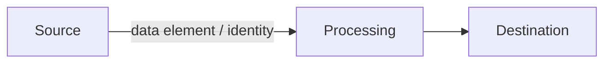

# Data-Flow Documentation Template

Complete one per use case, before pilot. A use case whose data flows cannot be drawn cannot be risk-assessed — and will not pass a serious security or privacy review. This template is designed so the finished document answers an auditor's questions before they are asked.

## 1. Flow Summary

| Field | Entry |
|---|---|
| Use case | |
| Data-flow owner (named individual) | |
| Date / version | |
| Risk classification (from [assessment](../03-security-governance/ai-risk-assessment.md)) | |

## 2. Data Inventory

| Data Element | Source System | Classification | Regulated? (HIPAA/PCI/CMMC/other) | Minimum-Necessary Justification |
|---|---|---|---|---|
| | | | | |

## 3. Flow Path

Document every hop. For each: **what moves, in what direction, under whose identity, encrypted how, logged where.**

| # | From | To | Data | Identity Context | Encryption | Logged To |
|---|---|---|---|---|---|---|
| 1 | | | | | | |

## 4. Residency, Retention, and Training-Use

| Question | Answer |
|---|---|
| Where is data processed (region/tenancy)? | |
| Is any data retained by the platform or model provider? For how long? | |
| Is customer data used for model training? (Require contractual **no**) | |
| Conversation/log retention period and disposal method | |

## 5. Exposure Analysis

- What is the most sensitive element that could appear in a model response?
- What prevents the agent from returning content the user cannot access? How was this tested?
- What does the flow look like during platform failure — where does in-flight data go?

## 6. Sign-Off

| Role | Name | Date |
|---|---|---|
| Use-case owner | | |
| Security | | |
| Privacy/Compliance (if regulated data) | | |
