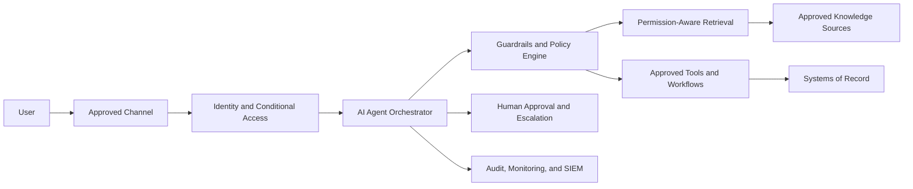

# Reference Architecture

A vendor-neutral pattern for deploying AI agents in regulated environments. Any candidate platform is evaluated against this structure; the platform must fit the architecture, not the reverse.

## The Pattern

Seven separated concerns: user experience, identity, orchestration, policy, knowledge, tools, and observability — with systems of record deliberately outside the agent's trust boundary.

## Layer Responsibilities

| Layer | Responsibility | Key Requirement |
|---|---|---|
| Approved channel | Where users meet the agent (desktop, ITSM console, contact center desktop) | No unmanaged or shadow channels |
| Identity | Authenticate user and agent; enforce conditional access | Agent is a governed nonhuman identity; user context flows through |
| Orchestrator | Session, state, model invocation, routing | Stateless toward systems of record; no data hoarding |
| Policy engine | Enforce scopes, injection defenses, output validation, approval gates | Controls enforced server-side, never by prompt alone |
| Retrieval | Fetch knowledge in the user's security context | Permission preservation; citations; content treated as untrusted |
| Tools | Execute approved, parameterized actions | Per-action gates from the [Human Approval Matrix](../03-security-governance/human-approval-matrix.md) |
| Systems of record | ITSM, contact center platform, directories, administrative systems | Remain authoritative; agent writes are drafts or gated commits |
| Human approval | The accountable decision point for consequential actions | Informed approval with step-up authentication |
| Observability | Full-path logging to SIEM | Every request attributable: user → agent → retrieval → action |

## Design Principles

- **Identity-aware end to end** — no layer operates on anonymous or pooled credentials
- **Least privilege by construction** — read and write identities separated; connector scopes enumerated
- **Source-permission preservation** — the retrieval layer can never out-privilege its user
- **Segregation of duties** — the agent that recommends is not the identity that executes
- **Human approval by risk tier** — autonomy is a granted, revocable privilege
- **Read-only first** — every deployment starts read-only; writes are earned through pilot evidence
- **Deterministic controls for critical paths** — safety-relevant logic lives in code and configuration, not model judgment
- **Full auditability** — reconstruction of any interaction from logs alone
- **Safe failure** — test fallback to normal operations against approved service and recovery objectives
- **Vendor-independent systems of record** — replacing the agent platform must never mean migrating operational truth

## Environment Progression

| Stage | Access | Exit Criteria |
|---|---|---|
| Sandbox | Synthetic data only | Controls testable end to end |
| Pilot | Production knowledge, read-only → draft-write | [Pilot success criteria](../05-measurement/pilot-success-criteria.md) met |
| Production | Tiered per approved risk classification | Continuous monitoring green; quarterly access review |

Companion documents: [Data-Flow Template](data-flow-template.md) · [Integration Inventory](integration-inventory.md) · [Zero-Trust Agent Controls](../03-security-governance/zero-trust-agent-controls.md)

