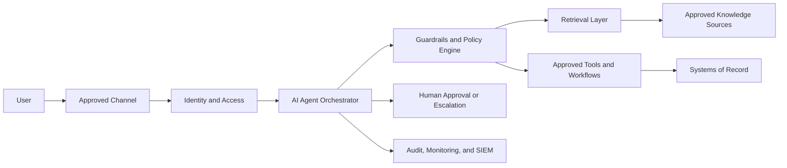

# Reference Architecture

## Architectural Pattern

The recommended pattern separates user experience, identity, orchestration, knowledge, tools, systems of record, and monitoring.

## Design Principles

- Identity-aware access
- Least privilege
- Source-permission preservation
- Segregation of duties
- Human approval for higher-risk actions
- Read-only pilot phase
- Deterministic controls for critical workflows
- Full auditability
- Safe failure and fallback
- Vendor-independent systems of record
